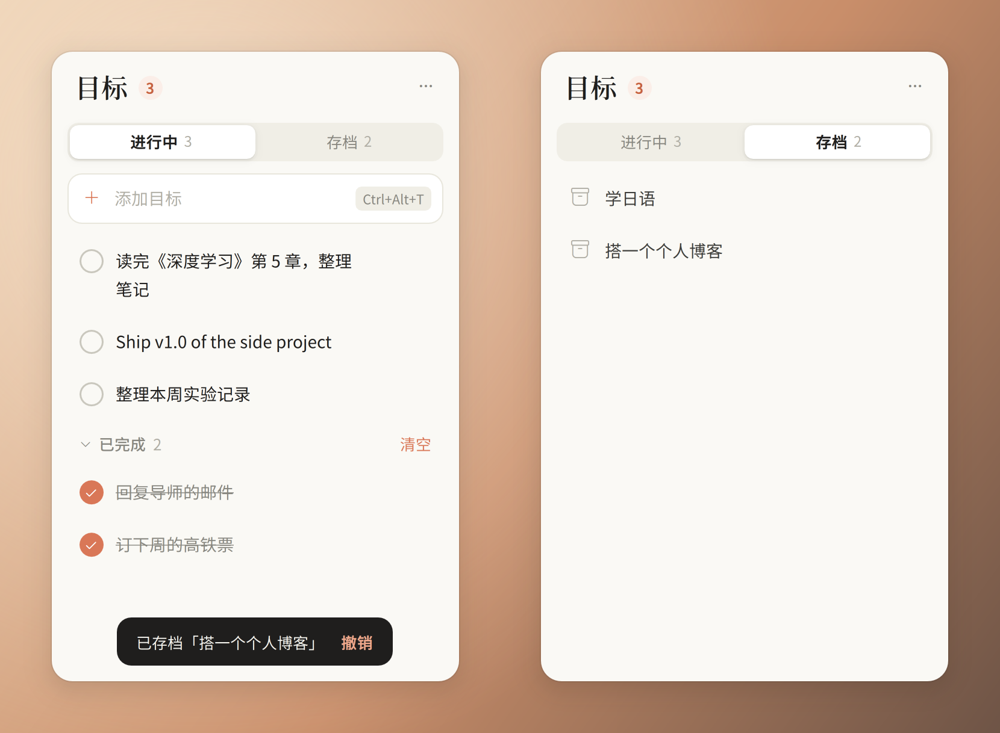

<div align="center">

# Desk Todo

**住在 Windows 桌面右上角的一张安静的目标清单。**

简体中文 · [English](README.md)

[](https://github.com/zzkws/Desk-Todo/actions/workflows/ci.yml)




</div>

Desk Todo 是一张一直在那儿的小卡片，用来记下你在电脑上真正想完成的事。它紧贴屏幕右上角，「显示桌面」也不会把它收起，层级和普通窗口一样，不打扰你。**现阶段不做**的目标放进**存档**，不再挤在清单里；**真正不做**的再删除。

外观借鉴了 Claude 的暖色调——象牙白的底、珊瑚色的强调——配上类苹果的圆角卡片、分段切换和干脆利落的动效。

## 特性

- **目标，而不是待办**：三种状态——进行中、已完成（划掉，可折叠）、存档（暂时不做）。删除留给「真正不做」。
- **钉在右上角**：紧贴屏幕上边和右边（也可以切换成离边 14px 的悬浮卡片），分辨率变化后自动归位，不能被拖走。
- **「显示桌面」不收起**：<kbd>Win</kbd>+<kbd>D</kbd>、触摸板三指下滑会收起其他窗口，它留在桌面上。
- **普通窗口层级**：点它就到前面，点别的窗口它就被盖住，不和系统规则较劲。
- **全局快捷键**：<kbd>Ctrl</kbd>+<kbd>Alt</kbd>+<kbd>T</kbd> 把它带到前面，光标直接在输入框里（被占用时自动顺延为 <kbd>Ctrl</kbd>+<kbd>Alt</kbd>+<kbd>Y</kbd> / <kbd>J</kbd>）。
- **可撤销**：存档、删除、清空已完成后，底部出现「撤销」，5 秒内有效，也可以按 <kbd>Ctrl</kbd>+<kbd>Z</kbd>。
- **拖动排序**：被拖的卡片紧贴鼠标，其他条目顺滑让位。
- **数据在你手里**：程序目录下的一个普通 JSON 文件；原子写入，每天自动备份（保留 30 天）；文件损坏时改名留档，绝不静默覆盖。
- **开机自启**：<kbd>⋯</kbd> 菜单里一键开关。

## 环境要求

- Windows 10 / 11
- Python 3.10+（64 位）
- [PySide6](https://pypi.org/project/PySide6-Essentials/) 6.9+

## 安装

```powershell
git clone https://github.com/zzkws/Desk-Todo.git
cd Desk-Todo
pip install -r requirements.txt
```

然后双击 **`launch.vbs`**（不弹控制台），或运行 `pythonw desk_todo.pyw`。

<details>
<summary>自包含安装（不把 PySide6 装进全局 Python）</summary>

```powershell
pip install -r requirements.txt --target _vendor
```

`_vendor/` 存在时，`desk_todo.pyw` 会自动从这里加载依赖。
</details>

已经在运行时再启动一次，只会把现有的卡片带到前面——始终只有一个实例。

## 使用

| 想做的事 | 怎么做 |
| --- | --- |
| 添加目标 | <kbd>Ctrl</kbd>+<kbd>Alt</kbd>+<kbd>T</kbd>（或点输入框），输入，按 <kbd>Enter</kbd>；可以连续添加 |
| 完成 / 恢复 | 点左边的圆圈 |
| 存档（暂时不做） | 鼠标悬停，点盒子图标 |
| 从存档恢复 | 切到「存档」→ 悬停 → 点返回箭头 |
| 删除（真正不做） | 鼠标悬停，点垃圾桶 |
| 修改 | 双击文字；<kbd>Enter</kbd> 保存，<kbd>Esc</kbd> 取消 |
| 排序 | 按住文字上下拖 |
| 改大小 | 拖卡片左下角 |
| 折叠成一条 | 双击标题 |
| 设置 | <kbd>⋯</kbd>：显示已完成、紧贴屏幕右上角、开机自启、打开数据文件夹、退出 |

## 数据

都在程序目录下的 `data/` 里：

```
data/
├─ todos.json           # 目标和界面状态
├─ backups/             # 每天一份，保留最近 30 份
└─ desk_todo.log        # Qt/QML 消息，界面出问题时看这里
```

想放到别处，设置环境变量 `DESKTODO_DATA_DIR` 即可。

> **为什么不放 `%APPDATA%`？** 从 MSIX 打包应用里启动的进程，看到的 `%APPDATA%` 是一份被重定向的私有副本。如果卡片是从这类应用里启动的，它读写的文件和开机自启时不是同一个，你的清单会悄悄分叉成两份。放在程序旁边的文件夹就没有这个问题。

## 开发

```powershell
python -m venv .venv
.venv\Scripts\pip install -r requirements-dev.txt
.venv\Scripts\ruff check .
.venv\Scripts\python -m pytest
```

测试在无界面模式下运行（`QT_QPA_PLATFORM=offscreen`），不会碰你的真实数据、鼠标和键盘。覆盖存储与迁移、后端的每个操作、QML 干净加载、拖动排序和焦点处理。

```
desktodo/
├─ app.py        # 入口：单实例、组装、资源管理器重启后自动拉起
├─ backend.py    # 暴露给 QML 的 QObject：三个列表模型 + 所有用户操作
├─ models.py     # 单个分区的 QAbstractListModel
├─ storage.py    # JSON 读写、迁移、备份（不依赖 Qt）
├─ desk.py       # 窗口定位、快捷键呼出、点框外失焦
├─ system.py     # 单实例锁、全局快捷键、开机自启
├─ winapi.py     # 用到的少量 Win32 调用（ctypes）
└─ qml/Main.qml  # 全部界面
```

`tools/make_screenshots.py` 用示例数据重新生成 `docs/screenshot.png`。

## 许可证

[MIT](LICENSE)
